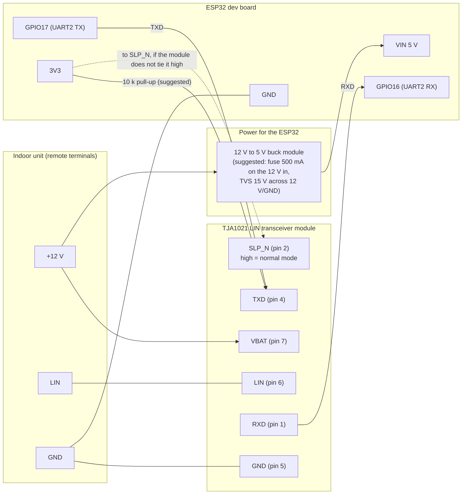
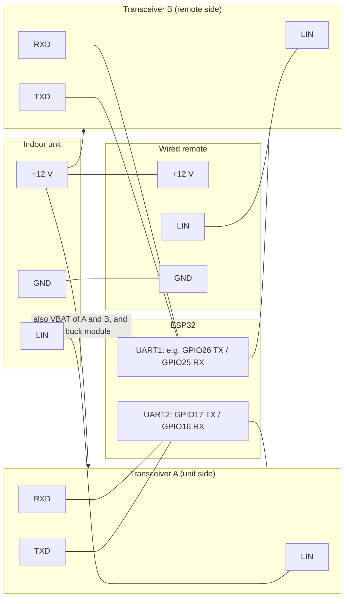

# AOT30L / ART30RL circuit

A suggested wiring for the [master controller](aot30-master-controller.md), and a sketch for the [bridge](aot30-master-controller.md#future-work-bridge-design-sketch-not-built).
The master controller wiring is the arrangement that ran successfully on 2 Nov 2026 (ESP32, a TJA1021 "linttl3" LIN transceiver module, GPIO16/17,
12 V and LIN from the remote's cable). The items marked **suggested** are additions I recommend but that have not been tried on this unit. Check every
voltage with a meter before connecting, and check your transceiver module's own pinout against its silkscreen: the pin numbers below are the TJA1021's.

## Facts the circuit relies on

- The remote's cable has three wires: **LIN** (signal), **+12 V** (the unit powers the remote) and **GND**.
- With the remote fully disconnected the LIN wire idles at **12 V**, so the unit already provides the bus pull-up. **Do not add a pull-up** on the master
  controller's side.
- An attached but unpowered remote clamps LIN to about 2.6 V, which is why all three wires must be removed from the remote, not just LIN.
- The ESP32's pins are 3.3 V; the TJA1021 accepts 3.3 V logic on TXD and drives RXD at the logic level of the module (check that your module's RXD is 3.3 V
  safe; many breakouts pull it up to 5 V).

## Master controller (the remote is removed)

| Connection | Notes |
|---|---|
| Unit +12 V to transceiver VBAT, and to the buck module input | The unit's remote-cable 12 V. |
| Unit LIN to transceiver LIN | The only signal wire. 12 V when idle. |
| Unit GND to transceiver GND and ESP GND | One common ground. |
| ESP GPIO17 to transceiver TXD | Idle high. The firmware drives it high at the start of `setup()` and bit-bangs it while transmitting. |
| Transceiver RXD to ESP GPIO16 | Firmware enables the internal pull-up on this pin so it cannot float and crash the ESP32. |
| 10 k from 3V3 to TXD (**suggested**) | Holds the transmitter recessive while the ESP32 boots, before the firmware takes over the pin. |
| SLP_N | Must be high for normal operation (low is sleep). Many modules tie it high, check yours. WAKE_N is not needed; INH is not used. |
| ESP32 supply | Powering it from the same 12 V through a buck module is the robust option. During the experiments it also ran from USB 5 V for the web logs; the GND must still be common. |
| Optional: status LED | GPIO2 (as in `aot30.yaml`). |

**Protection (suggested):** a small fuse in the 12 V feed and a TVS diode (for example 15 V standoff) across 12 V and GND at the module, since the line runs
through the building and the remote's cable. A series resistor is not needed on LIN; the transceiver handles the bus.

## Bridge (sketch, not built)

For the bridge the remote stays, so its 12 V and ground still come from the unit; only the **LIN wire is split** into two buses.

- 12 V and GND pass straight through to the remote, so the remote is powered exactly as before. Add the fuse and TVS at the unit end.
- Transceiver A is the same as in the master controller circuit. Transceiver B faces the remote, which acts as a bus master on its own wire.
- **To verify before building:** whether the remote-side wire idles high on its own. If it does not (the unit may provide the pull-up in the original
  installation), the remote side needs a pull-up to 12 V (typically about 1 k in series with a diode, as for a LIN master). Measure the original LIN
  wire with the remote connected and the unit powered; the earlier multimeter reading was 8.2-9.3 V, which suggests an average of a pulsing line rather than
  a plain high level, so look at it with the logic analyser.
- The second transceiver also needs the same TXD pull-up and the pin choices above must not clash with the strapping pins (GPIO0, 2, 12, 15) or the
  flash pins.

### What is shared and what is repeated

| Built once | Repeated for each transceiver (A and B) |
|---|---|
| 12 V feed from the unit, one fuse, one TVS diode | 10 k pull-up from 3V3 to TXD (holds it recessive while the ESP32 boots) |
| Buck module and the ESP32 | SLP_N tied high (unless the module already does it) |
| Common ground and the 3V3 rail | VBAT supply connection and a local 100 nF decoupling capacitor (most breakouts already have one, check yours) |
| Remote's 12 V and GND, passed straight through from the unit | Its own TXD/RXD pair on its own UART |

- No capacitor is needed on the LIN pin for a short in-building run (the 220 pF-1 nF EMC capacitor used in vehicles is optional).
- **Not simply a copy of A:** the remote-side wire may need a pull-up to 12 V (about 1 k in series with a diode), because the unit provides the pull-up today and
  the remote would no longer be connected to it. Measure before building.
- One transceiver cannot serve both buses, because the ESP has to talk to the unit and answer the remote at the same time. Software side: the unit-side
  half is the existing `Aot30Bus` master; the remote side would be a new slave class plus a cell-level decoder for the remote's settings.
