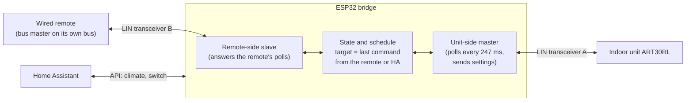
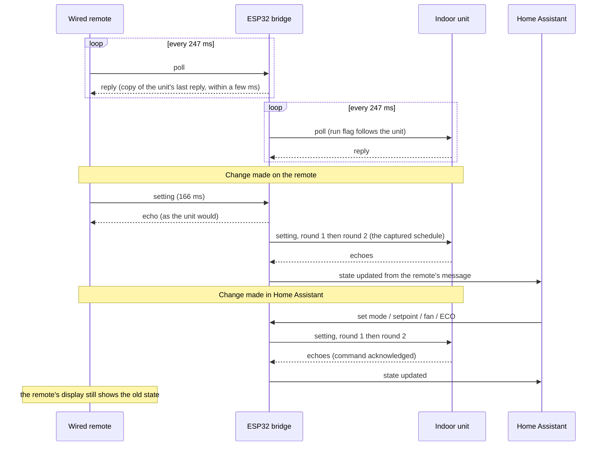

# AOT30L / ART30RL master controller

Status: **experimental**. The protocol work is based on logic-analyser captures and one successful run on real hardware (2 Nov 2026, remote
disconnected, unit started from the ESP). The `fujitsu_aot30` component (Master Controller switch, climate entity) has passed the host tests but has
**not yet been built or run on the ESP32**.

This is a separate component from the original `fujitsu_climate` (the newer units' 8-byte frame protocol, unchanged from upstream): see the
[README](../README.md#which-component-for-which-unit).

## What it does

The older ducted Fujitsu units (indoor ART30RL, outdoor AOT30L, wired remote part 9364911014, 3-wire LIN-style bus at 12 V) do not talk the
8-byte frame protocol of the newer units. The wired remote is the **bus master**: it polls the unit about every 247 ms and the unit only
replies. So Home Assistant control means the ESP32 **replaces the wired remote**:

- It polls the unit continuously, exactly as the remote does.
- Climate commands (mode, setpoint, fan, ECO, off) are turned into the captured setting and off messages.
- The unit shuts itself off when polling stops, so turning the master controller off also turns the unit off.

The physical remote cannot stay connected. A setting message is 164 ms long, the free gap next to a live remote is 30-58 ms, and the unit rejects a
setting sent even 20 % faster (speed-ladder test, 2 Nov 2026). Keeping the remote needs a bridge, see [Future work](#future-work-bridge).

## Hardware

- ESP32 with a LIN transceiver (TJA1021, "linttl3"). RX is GPIO16, TX is GPIO17 (see `aot30.yaml`). A suggested circuit is in [aot30-circuit.md](aot30-circuit.md).
- Transceiver powered from 12 V. Power the ESP32 from 5 V or from the 12 V rail through a regulator.
- **Disconnect the wired remote completely: LIN, power and ground.** An attached but unpowered remote clamps the LIN line low (measured 2.6 V);
  with all three wires removed the LIN idles at 12 V.

## Home Assistant entities

| Entity | Purpose |
|---|---|
| **Master Controller** (switch) | On: the ESP takes over the remote's role. Remembered across reboots. It turns itself off if the controller refuses to start or has to stop. |
| **Master Controller Status** (text) | `Off`, `Checking bus`, `Running`, or why it refused or stopped (see below). |
| **Master Last Command** (text) | Whether the unit echoed the last setting or off message (`Acknowledged by the unit` / `Not acknowledged by the unit`). The unit repeats what it accepts, so this checks every command, including setpoints and modes not yet tried on the real unit. |
| **Unit Running** (binary sensor) | The run flag in the unit's own replies. Unknown until the unit has answered a poll. |
| **Bus Alive** / **Bus Status** | Recognised messages are arriving (`Bus OK`, `No Signal`, `Never Seen`). Works with the Master Controller off and the real remote connected. |
| **Fujitsu Heat Pump** (climate) | Modes Off/Auto/Cool/Heat/Fan, setpoint, fan Auto/Low/Medium/High, preset ECO. While the master controller runs, the climate state is the last state the ESP commanded. With the Master Controller off, commands are ignored and the state is a best-effort view of a connected remote (see Known limits). |
| **Mode**, **Set Temperature**, **Fan Speed**, **Economy Mode** | Duplicates of the climate controls for the ESPHome web UI (its climate row has no usable mode or fan control) and for Auto mode, where HA hides the target temperature. |

In Home Assistant the climate entity (`climate.fujitsu_heat_pump`) appears by itself once the device is added; show it with a Thermostat card (the
auto-generated dashboard already does). Its mode list is Off/Auto/Cool/Heat/Fan only. Commands do nothing until the Master Controller switch is on.

Supported: HEAT 16-30 °C, COOL 18-30 °C, AUTO 18-30 °C, FAN (no setpoint), fans auto/low/medium/high, ECO.
Not available on this unit: DRY, quiet fan, vane control (so no swing entity), room temperature. Out-of-range setpoints are clamped. The room temperature is not on the bus.

## Installing

Use [`aot30.yaml`](../aot30.yaml) (rename the device if you like) and keep `components/fujitsu_aot30/` next to it, or point `external_components` at the
repository instead of the local path:

```yaml
external_components:
  - source:
      type: git
      url: https://github.com/matt-nz/Retro-Fujitsu-ESPHome
      ref: <branch>
    components: [ fujitsu_aot30 ]
```

`debug: true` on the climate platform logs every received byte as `RX raw` lines (what `tools/decode_timeline.py` reads); set it to `false` for quieter logs.

## Starting it

1. Disconnect the wired remote (all three wires) and power the unit.
2. Turn on **Master Controller**. It checks that the bus is silent for 1.5 s and idles high, polls for 2 s, then reports `Running`.
3. Use the climate entity. A change takes about 1.5 s to go out (two setting rounds, as the remote sends them).
4. Turn the switch off to stop. The unit shuts down.

## Safety behaviour

| Status | Meaning |
|---|---|
| `Refused: wired remote is on the bus` | Wired-remote messages were heard while checking. Disconnect the remote and try again. |
| `Refused: bus held low` | The LIN line did not idle high. Check that the remote is fully disconnected and the line reads 12 V. |
| `Stopped: wired remote detected` | Two remote messages were heard while running; the bus was handed back at once. |
| `Stopped: bus fault while sending` | Three transmitted cells did not read back correctly (another device on the line, or a wiring fault). |

Every transmitted cell is read back from the bus. The ESP never transmits within 12 ms of the last received byte, and always releases the pin
(idle high) after a message. The transmit pin is driven high early in `setup()`.

## Known limits

- The climate state is what was commanded, not what the unit reports. Only the run flag comes from the unit (`Unit Running`). Setting echoes
  cannot be decoded from the byte view (the old `0x96` "unmapped" log line is that aliasing).
- If the ESP reboots or loses power, the unit kept running for 1 minute in the one timed test (it shut down exactly 1 minute after the last poll, with the
  compressor not running; with the compressor running for a while it may differ, untested). So a reboot or WiFi drop should not switch it off. An OTA
  update plus reboot takes a good part of that minute, so do not rely on it for long gaps. The Master Controller switch is restored on boot.
- The unit occasionally skips a reply (3 of 52 polls in one capture). The master tolerates that.
- Round 2 of a setting was missing from the unit's echo 3 times in 50 on the real remote; it makes no difference here.

## Protocol summary

The full protocol is in [aot30-protocol.md](aot30-protocol.md); the investigation log is in [protocol-investigation-status-2026-10-31.md](protocol-investigation-status-2026-10-31.md).

- Code, all in `components/fujitsu_aot30/`: `Aot30Cells.h` (message cells), `Aot30Scheduler.h` (timing script), `Aot30Passive.h` (message parser), `Aot30Bus.cpp` (bus task: reading, master controller, bit-banged transmit), `Aot30Climate.cpp` (HA climate entity).

## Tests

`sh tests/run_all.sh` runs everything on a desktop: capture decoding, the cell encoder against 677 golden vectors from the Python model, the
scheduler, and the master controller with fake time, GPIO and UART. ESPHome itself is built in the HA add-on.

## Future work: bridge (design sketch, not built)

A bridge keeps the physical remote usable. The ESP sits between the unit and the remote with a **second LIN transceiver** and treats the two as
**independent buses**: master towards the unit, slave towards the remote. It never has to delay the remote, because it answers the remote's polls itself,
from the unit's latest reply, within the few milliseconds the remote expects (the reply starts 1.75-6 ms after the poll ends).





- **What is already built:** the unit-side master (`Aot30Bus`, `Aot30Scheduler`, `Aot30Cells`) is exactly the current master controller.
- **What is new:** a second UART and transceiver for the remote side, a slave that can answer a poll in a few milliseconds, and a receive-only decoder for the
  remote's setting cells (GPIO edge timestamps), because the byte view aliases (see [aot30-protocol.md](aot30-protocol.md#5-the-byte-view-and-why-it-aliases)).
- **Open questions:** how the remote reacts to synthetic echoes and replies (does it accept them, does it show a fault), what it sends at the very start of a
  cold start with no unit answering, and whether the remote's display can be made to follow Home Assistant's changes by echoing a setting to it. If the
  remote's display cannot follow, the two will show different states after a change from Home Assistant.

## Open question: room temperature

No room temperature has been seen on the bus. Over about 21 min of passive logging (`idle.log`, 5,205 polls and 5,206 replies, unit off) and several
minutes of running (`cold.log`, `hot-fan-cold-auto.log`, `heat_20_22_18.log`) the poll is always `7F 28 13|17 08|0A` and the reply `7F 18 13|17 48 80`;
only the run and pending flags vary. The run flag follows on/off commands, not a thermostat. The longest continuous on-stretch is only about 3-4 min,
so a slowly changing or rare temperature message cannot be ruled out. The unit most likely uses its own return-air sensor.

To confirm: (1) check whether the wired remote's display shows a room temperature, (2) with the master controller running, set HEAT 16 and then
HEAT 26 in a room at about 21 °C for 20-30 min each and see whether the unit throttles back or stops, and (3) capture 45-60 min of passive logs
with the real remote and the unit on, then look for any message other than the four poll and two reply patterns.

## Using a Home Assistant room sensor (setpoint offset)

The unit regulates on its own return-air sensor and shuts the compressor down once that reads the setpoint. To make the *room* reach a target,
let HA move the unit's setpoint by the difference between the room sensor and the target. This only changes what the master controller sends, nothing
on the bus. Rules for the automation:

- The setpoint is whole degrees: HEAT 16-30, COOL and AUTO 18-30. Clamp the result to the mode's range.
- Each change is two setting rounds over about 1.5 s. Change it rarely: re-evaluate every 5-10 minutes and only act on a change of at least 1 °C.
- Keep the master controller on while the unit idles: polling must continue even when the compressor is stopped, and the status stays `Running`.
- Do not send off/on for thermostatting; move the setpoint instead.

Example (heating, adjust the entity ids to yours):

```yaml
alias: Aircon room temperature trim
trigger:
  - platform: time_pattern
    minutes: "/10"
condition:
  - condition: state
    entity_id: switch.master_controller
    state: "on"
  - condition: state
    entity_id: climate.aircon
    state: "heat"
action:
  - variables:
      target_room: 21
      room: "{{ states('sensor.living_room_temperature') | float(none) }}"
      current: "{{ state_attr('climate.aircon', 'temperature') | float(none) }}"
      new: "{{ [16, [30, (current + target_room - room) | round(0)] | min] | max }}"
  - condition: template
    value_template: "{{ room is not none and current is not none and new != current }}"
  - service: climate.set_temperature
    target:
      entity_id: climate.aircon
    data:
      temperature: "{{ new }}"
```

The climate entity's temperature is the last setpoint the ESP sent, so it is the right value to offset from.

## Entities removed for this unit

`aot30.yaml` does not carry the entities of the newer units' 8-byte frame protocol, which can never be populated on this bus: Room Temp, Swing Icon,
Raw Frame To Us/Other, Sync Mismatch, Out of Sync Since, In Sync, Last Change Source/Detail, Thermo Sensor Icon, Defrost Active, the Thermo Sensor
experiment select and write-test switch, and the Safe Mode Boot button (ESPHome's own safe mode still works for recovery). Dry mode and the Quiet fan
speed are not offered. The `Aot30Climate` component is a separate, self-contained component, so none of that code is carried.
