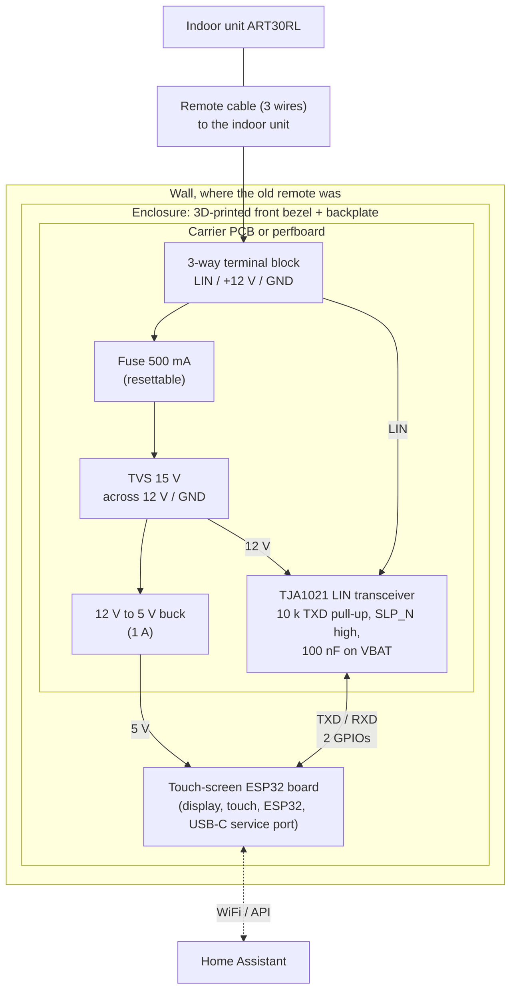
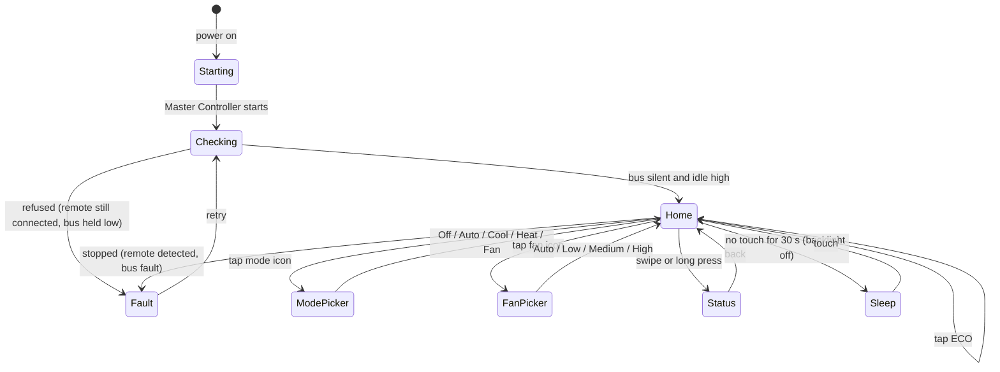

# AOT30L / ART30RL touch-screen controller (finished design)

A wall-mounted replacement for the wired remote: an ESP32 touch-screen board running the [master controller](aot30-master-controller.md) with a local UI, still
controllable from Home Assistant. This is a **design proposal**; nothing here has been built or tested. Prices are rough and parts must be checked
against current listings. The [circuit](aot30-circuit.md) and [protocol](aot30-protocol.md) documents are the technical basis.

## 1. System view

## 2. Screens (what the UI does)

- **Home:** large setpoint, current mode and fan icons, ECO, power, a small "unit running" dot and "command acknowledged" tick (from `Master Last Command`).
- **Status:** Master Controller state, bus alive, WiFi/HA connection, firmware version, and the last command result.
- **Fault:** the reason from `Master Controller Status` in plain words, with a Retry button.
- The UI talks to the climate entity with `make_call()`, so a command from the screen and one from Home Assistant take the same path. The screen works with no WiFi.

## 3. Bill of materials

| # | Part | Notes | Rough cost |
|---|---|---|---|
| 1 | ESP32 touch-screen board | Options below. Needs 2 free GPIOs and 5 V. | US$15-50 |
| 2 | TJA1021 LIN transceiver module | The "linttl3" you already have. Check RXD is 3.3 V safe. | US$3-8 |
| 3 | 12 V to 5 V buck module, 1 A | MP1584EN or LM2596 type, set and check 5.0 V before connecting the board. | US$2 |
| 4 | Resettable fuse, 500 mA (or a 500 mA fuse and holder) | On the 12 V input. | US$1 |
| 5 | TVS diode, 15 V standoff (for example SMBJ15A) | Across 12 V and GND at the input. | US$1 |
| 6 | 10 k resistor and a 100 nF capacitor | TXD pull-up; VBAT decoupling if the module lacks it. | cents |
| 7 | 3-way pluggable terminal block (5.08 mm) | Lets the unit-side cable be unplugged without desoldering. | US$2 |
| 8 | Carrier board | Perfboard for one unit; a small custom PCB (KiCad, ordered from a PCB fab) if you want it neat or want to make more than one. | US$2-10 |
| 9 | Enclosure: 3D-printed bezel and backplate | PETG or ASA; ABS is also fine. Heat-set M3 inserts and screws. | filament only |
| 10 | Mounting | See below. | US$0-15 |
| 11 | Wire, ferrules, heat-shrink, standoffs | | US$5 |

**Screen board options** (pick by size and touch type):

| Board | Screen | Touch | Notes |
|---|---|---|---|
| ESP32-2432S028 ("cheap yellow display") | 2.8 in, 320x240 | resistive | Cheapest; well supported by ESPHome; the free GPIO header is limited, check which pins are free (one may be input only, fine for RX). |
| Sunton ESP32-S3 4.3 in (for example ESP32-8048S043) | 4.3 in, 800x480 | capacitive | Nicer for a wall unit; ESP32-S3 (the bus code is untested on S3 but uses only UART2 and the GPIO matrix). |
| Waveshare ESP32-S3 Touch LCD 4.3 | 4.3 in, 800x480 | capacitive | Similar; has extra IO and a USB-C port. |
| M5Stack Core2 / CoreS3 | 2 in | capacitive | Ships in its own case, so no printing; fewer free pins and bigger footprint for the price. |

**Mounting and finish options (choose one):**
1. **Reuse the old remote's wall fixing.** Remove the remote, measure its screw spacing and cable position, and print a backplate with the same holes and a cable entry.
2. **Standard wall plate.** Print the bezel to fit a standard single-gang wall box or mounting block so it looks like a normal switch plate; the cable enters from the back.
3. **Surface-mount box.** A backplate plus a snap-on bezel; simplest if the wall cable comes out of the wall rather than a box.
- Leave a vent slot above the buck module and keep the 5 V board's antenna end clear of metal for WiFi.
- Print a small label on the inside: wire colours and "12 V on this terminal" so the next person does not mix them up.

## 4. Build checklist

1. Measure the remote cable with the remote removed: LIN idles at 12 V, plus 12 V and GND (see [aot30-circuit.md](aot30-circuit.md)). Disconnect **all three** wires from the old remote.
2. Bench-assemble the carrier board with a 12 V supply and a 100 ohm load on LIN; check the 5 V rail, TXD high at idle, and that RXD follows LIN.
3. Flash [`aot30.yaml`](../aot30.yaml) first with no screen code and confirm the Master Controller runs on the unit.
4. Add the LVGL/touchscreen configuration for the chosen board and test it on the bench.
5. Mount, connect, and watch `Master Controller Status`, `Master Last Command` and `Unit Running` for a day.
6. Time the unit's shutdown after polling stops once the compressor has been running a while (the 1 minute was measured with it off).

## 5. The core 0 question, and the better fix

The screen is drawn by the ESPHome main loop on core 1, and the bus task busy-waits on core 1 for 87 ms of every 247 ms poll cycle (166 ms for a setting), so the UI
would stutter. Options, in order of effort:

| Option | Work | Risk |
|---|---|---|
| Pin the bus task to core 0 | One line (the core argument of `xTaskCreatePinnedToCore` in `Aot30Climate.cpp`) | Core 0 normally runs the WiFi stack. A busy-wait at top priority could starve WiFi for up to 166 ms at a time, and at a lower priority WiFi activity could jitter the cell timing and trigger read-back aborts. **Worth a 10-minute trial, not a certainty.** Untested. |
| A hardware timer (gptimer) interrupt toggles the pin at the precomputed edge times | A few hours | The CPU is free between edges; interrupt latency is small unless flash operations disable the cache. Untested. |
| **RMT (recommended)** | Half a day to a day, plus testing | The ESP32's RMT peripheral sends the precomputed pulse train with microsecond timing and no CPU, so nothing stutters on either core. The longest pulse is 15.8 ms, which fits an RMT symbol. The read-back would become a post-message comparison of captured edges instead of a per-cell check. It is also step 2 of the bridge plan, so it is not wasted. |

Suggested order: try core 0 for ten minutes while watching for `read-back mismatch` and WiFi drops; if either appears, do RMT.

## 6. What is not decided

- Board choice and the exact GPIOs that are free on it.
- Whether to make a PCB or use perfboard.
- Mounting, until the old remote has been measured.
- Whether the UI should show an ambient temperature: the unit sends none (see the room temperature note in the master controller doc), so it would have to come from a Home
  Assistant sensor or a local sensor.
